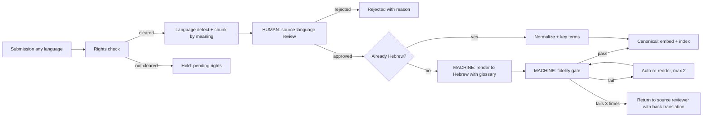

# Hebraic.ai — Hebrew Canonical Data Layer
**Technical Specification, Draft v0.3**
Owner: Jacob Hebraic (COO, Hebraic.ai), for Mr. George Bakalov — October 4, 2026
Status: Draft for review. Not yet implemented.
v0.2 change (per Mr. George, October 4, 2026): people review the submission **in its source language**; once it is approved, the **model alone** renders it into Hebrew. Reviewers do not need to know Hebrew. The human checkpoint is on the source, and the machine checkpoint is on the Hebrew rendering.

---

## 0. Principle (as set by Mr. George)
1. Every piece of knowledge submitted to Hebraic.ai, in any language (English, Russian, Bulgarian, German, French, Italian, Czech, and others), is ingested and stored as a **canonical Hebrew record** that preserves its meaning.
2. The original language is kept **only as provenance metadata**. It is never the reference text.
3. **Hebrew is the reference language.** Meaning is preserved through Hebrew, retrieved through Hebrew, and explained to the user from Hebrew in the user's own language.
4. **Hard constraint:** nothing is served to a user unless it already exists in the Hebrew layer, its source was approved by a person, and its Hebrew rendering passed the automated fidelity gate.
5. **Two checkpoints:** a person checks the *meaning of the source*, and the model is trusted with the *conversion into Hebrew*.

## 1. Scope
**In scope:** knowledge items (articles, book excerpts, scholar notes, user submissions, corrections), chunking, conversion to Hebrew, review, storage, indexing, retrieval, and gating what may be served.
**Out of scope for v0.1:** the Tanakh base text itself, which is handled under Colab issue #1 (a rights-cleared house Hebrew Tanakh with verse-aware retrieval). This layer links to that text by verse reference but does not replace it. Also out of scope: UI and billing.

## 2. Canonical record schema
Proposed Supabase (Postgres) tables in project `hebraic-ai`. They sit alongside, and will eventually replace, the current `knowledge_items` and chunk tables.

### 2.1 `canon_source` — one row per submitted work or document
| Field | Type | Notes |
|---|---|---|
| id | uuid PK | |
| title_original | text | Title as submitted |
| title_he | text | Hebrew title, which is the reference title |
| author | text | |
| rights_holder | text | e.g. Magnes Press, Jerusalem Perspective, ETRFI |
| license_status | enum | `public_domain`, `permission_granted`, `pending`, `denied`, `user_owned` |
| license_terms | jsonb | Citation wording, link-back requirement, display limits |
| original_language | text (ISO 639-1) | Provenance only. Values may include `ru` and others outside the UI language list. |
| source_uri | text | URL, ISBN, or archive reference |
| submitted_by | uuid → profiles | |
| submitted_at | timestamptz | |
| ingest_status | enum | `received`, `in_source_review`, `source_approved`, `rendering`, `canonical`, `rejected`, `render_failed` |
| source_reviewed_by | uuid → profiles | Reviewer fluent in the source language |
| source_reviewed_at | timestamptz | |
| source_review_notes | text | e.g. "Author's claim in §3 is speculative; keep as such" |

### 2.2 `canon_record` — the canonical Hebrew unit, one row per meaning-chunk
| Field | Type | Notes |
|---|---|---|
| id | uuid PK | |
| source_id | uuid → canon_source | |
| seq | int | Position within the source |
| he_text | text NOT NULL | **Canonical Hebrew text** (Modern Hebrew prose, with Biblical/Rabbinic terms preserved as written) |
| he_text_normalized | text | Without niqqud or cantillation, for matching |
| he_key_terms | text[] | Hebrew lemmas and roots (e.g. `שׁ־ל־ם`) |
| verse_refs | text[] | Normalized OSIS references, e.g. `Matt.5.17`, `Isa.53.5` |
| original_text | text NOT NULL | Source text verbatim (provenance) |
| original_language | text | Provenance |
| original_span | int4range | Character offsets in the source |
| render_method | enum | `native_hebrew`, `machine` (only machine rendering is used in v0.2) |
| render_model | text | Model and version used, plus prompt version |
| fidelity_score | numeric(3,2) | 0–1, from the round-trip check (§3.4) |
| fidelity_flags | jsonb | Terms lost, names altered, negations flipped, quotations changed |
| source_review_status | enum | `pending`, `approved`, `rejected`: the person's decision on the **source chunk** |
| render_gate_status | enum | `pending`, `passed`, `retrying`, `failed`: the machine's decision on the **Hebrew rendering** |
| render_attempts | int | Number of automatic re-renders |
| gate_passed_at | timestamptz | |
| version | int | Increments on any change to `he_text` |
| supersedes_id | uuid → canon_record | Version chain; edits never overwrite a record |
| submitted_at | timestamptz | Inherited from the source |
| created_at / updated_at | timestamptz | |

### 2.3 `canon_alignment` — semantic links between original and Hebrew
| Field | Type | Notes |
|---|---|---|
| record_id | uuid → canon_record | |
| original_span | int4range | A phrase in `original_text` |
| he_span | int4range | The matching phrase in `he_text` |
| link_type | enum | `equivalent`, `paraphrase`, `term_preserved`, `transliteration`, `quotation` |
| note | text | Model's rendering note, e.g. "Greek *logos* rendered as דָּבָר" |

The alignment table is generated by the model. It lets an auditor, and later a premium user (Colab issue #3, source tracing), see which Hebrew phrase came from which original phrase without needing to read Hebrew, because each Hebrew phrase is shown with its back-translation.

### 2.4 `canon_term` — controlled Hebrew vocabulary (glossary)
Locked renderings for recurring terms, such as Yeshua, Torah, Kingdom of Heaven, Messiah, grace, and the names of the Sages. Each entry has the Hebrew form, accepted source-language equivalents, and a short note. The glossary is fed into every rendering so that terminology does not drift between records.

## 3. Ingestion pipeline (human checks the source, machine renders the Hebrew)

### 3.1 Rights check (gate 0)
No source enters review unless `license_status` is `public_domain`, `permission_granted`, or `user_owned`. Translating a copyrighted text into Hebrew creates a derivative work, so permission letters must cover **translation and storage in Hebrew**, not just retrieval.

### 3.2 Language detection and chunking
- Detect the language and store it as `original_language`.
- Chunk by meaning (paragraph or argument unit, about 150–400 words) so that a single claim is never split.
- Extract verse references and normalize them to OSIS format.
- Chunking happens **before** review, so the reviewer approves exactly the units that will be rendered.

### 3.3 Human checkpoint: review in the source language (gate 1)
- Reviewers read the submission **in the language it was submitted in**. A Bulgarian article is reviewed by a Bulgarian reader, a Russian article by a Russian reader, and so on. **No Hebrew knowledge is required.**
- The reviewer confirms four things:
  1. The text is accurately captured from the source (no OCR or paste errors).
  2. It is correctly attributed to its author.
  3. It belongs in the library (doctrinally appropriate and on topic).
  4. Its meaning is clear enough to render. Ambiguous passages get a note in `source_review_notes`, which the model receives as context.
- The decision is recorded per source, with per-chunk overrides: `approved` or `rejected`, plus the reviewer, a timestamp and notes.
- The existing `knowledge_submissions` and corrections queue is reused.
- Approval of the source triggers rendering automatically. No further human step is needed for a record to become canonical.

### 3.4 Machine checkpoint: Hebrew rendering (gate 2)
**Rendering.** An LLM with a fixed, versioned prompt renders the approved chunk into Hebrew. It also receives the `canon_term` glossary, the surrounding chunks for context, and the reviewer's notes. The rules:
- Preserve the author's claim, not the style.
- Quote scripture from the Hebrew source text, never freely re-translated (Tanakh in the original; NT through the approved Hebrew NT).
- Use standard Hebrew forms for names.
- Never add or drop an interpretive claim.

The model also emits the alignment rows (§2.3).

**Fidelity gate.** This check is fully automated and is the machine's own quality control:
1. **Back-translation:** an independent model or prompt translates `he_text` back into the source language.
2. **Rubric judge:** a model scores meaning equivalence from 0 to 1 and raises a hard flag for any of these:
   - a negation changed,
   - a claim added or dropped,
   - a glossary term rendered differently from its locked form,
   - a name or reference altered,
   - an attribution changed.
3. **Cross-lingual embedding similarity** between the original and the Hebrew serves as a secondary signal.
4. **Deterministic checks:**
   - every verse reference in the original appears in `verse_refs`,
   - glossary terms are used exactly,
   - numbers and dates match,
   - the length ratio stays within the expected band for the language pair.

| Result | Action |
|---|---|
| Score ≥ 0.90, no hard flags, deterministic checks pass | **Canonical.** Embed and index automatically. |
| Below threshold, or any flag | Automatic re-render with the flags fed back, up to 2 retries |
| Still failing after 3 attempts | `render_failed`. The chunk returns to the **source-language reviewer**, who sees the back-translation in their own language and can clarify the source note, split the chunk, or reject it. It is never served. |

The 0.90 threshold is set initially and will be tuned during the benchmark in §3.6.

### 3.5 Corrections
- A correction to the source goes back through gate 1 (source review), and a correction to meaning is made on the source rather than on the Hebrew.
- Every change creates a new Hebrew version through gate 2, linked to the previous one by `supersedes_id`. Only the newest version that passed is served.
- Users and reviewers do not edit the Hebrew directly.

### 3.6 Evaluation (no Hebrew-speaking reviewers needed)
Since no one reviews the Hebrew directly, trust in the machine checkpoint is earned by measurement:
- **Launch benchmark:** source-language reviewers produce a test set of 100 approved chunks across bg, en, ru and de. Each chunk is rendered to Hebrew and back-translated, and reviewers grade the back-translations in their own language for meaning preserved, minor drift or major drift. To pass, at least 95% must be graded "preserved" and none "major drift".
- **Ongoing audit:** every week, 5% of canonical records are sampled at random, and reviewers grade their back-translations in the source language. The weekly brief reports the drift rate.
- **Drift alarm:** if the weekly major-drift rate goes above 1%, automatic canonization pauses until the prompt or model is corrected.
- **Model or prompt change:** any new `render_model` or prompt version must pass the launch benchmark again before use, and all records carry their version so that a regression can be re-rendered.
- **Optional:** an occasional outside check by a Hebrew scholar on a small sample. This is advisory only and not a gate.

## 4. Storage and indexing (Hebrew as the primary retrieval key)
- **APPROVED DECISION (Mr. George, October 4, 2026): the embedding model is BGE-M3** (`BAAI/bge-m3`, 1024 dimensions, 8K-token input), replacing OpenAI `text-embedding-3-small`.
  - **Hosting:** a hosted API, DeepInfra as primary (about $0.010 per 1M tokens), with Cloudflare Workers AI as fallback. No self-hosting.
  - **Cost:** about $0.35 to embed the whole library of roughly 100,000 passages once. Monthly updates and queries cost under $1, even at 100,000 questions a month.
  - **Why:** BGE-M3 scored best on Hebrew in published tests (Recall@100 on Hebrew MKQA: 72.4, against 58.1 for OpenAI 3-large). It is also about 3 times more token-efficient on Hebrew (1.75 tokens per word, against 5.4 on OpenAI's tokenizer).
- **Primary vector index:** a BGE-M3 embedding of `he_text` (pgvector `vector(1024)`, HNSW). Vector retrieval is matched against this index.
- **Hebrew normalization (approved):** apply NFKC, strip niqqud and cantillation (U+0591–U+05C7), and handle final letters the same way, identically at indexing and at query time. The lexical index stores **both the original tokens and prefix-stripped forms** (ו ה ב ל מ ש כ) in `he_text_normalized`, using the `simple` tsvector configuration, plus Hebrew stopwords.
- **Hybrid search (approved):** BM25-style full-text search and the pgvector search are combined with reciprocal rank fusion (Supabase hybrid-search pattern, k≈35–60). Exact `verse_refs` and `he_key_terms` matches are boosted.
- **Reranker (approved):** a cross-encoder (`bge-reranker-v2-m3`, hosted) re-scores the top 50 merged results before the final top results are passed to the answer model.
- **Benchmark (approved):** before the switch, build a test set of at least 100 real question-and-passage pairs from the logged Bulgarian and English questions. Measure Recall@10, NDCG@10 and the share of questions that find a library match, both on the current setup and after each change. Later, once 1,000–3,000 logged pairs exist, fine-tune the embedder and reranker.
- **Query flow:**
  1. The user asks a question in any language.
  2. The question is rendered into Hebrew, using the same glossary.
  3. A hybrid search runs: Hebrew vector search, Hebrew lexical search, and an exact `verse_refs` match.
  4. Results are merged and ranked.
- **Language filter removed:** retrieval no longer filters by the user's UI language. This directly fixes today's problem, where 59 of 59 retrievals last week found nothing because questions are filtered by UI language.
- **Original-language embeddings (optional):** these may be kept for recall diagnostics only and are never used to choose what is served.
- **Answer generation:** the model receives the Hebrew records and explains them in the user's language, citing the source and, for premium users, showing the Hebrew text.

## 5. Constraints and enforcement
| # | Constraint | Enforcement |
|---|---|---|
| C1 | Nothing is served unless it exists in the Hebrew layer | The retrieval RPC reads only from the view `canon_servable`, which requires `source_review_status = 'approved'`, `render_gate_status = 'passed'`, the latest version, and a non-null `he_text`. The old chunk tables are revoked from the `anon` and `authenticated` roles. |
| C2 | Original text is provenance only | Not exposed to the answer model's context in v0.1, apart from the premium source-trace view. |
| C3 | No uncleared source in any layer | Rendering refuses unless the license is cleared. A database check constraint applies to `canon_source`. |
| C4 | Full auditability | Every record keeps the source reviewer, the model, the prompt version, the fidelity score and flags, timestamps and the version chain. |
| C6 | People approve the source; only the machine writes the Hebrew | No user interface for editing Hebrew by hand; `he_text` can be written only by the rendering service role. |
| C5 | No unsourced answers | When retrieval returns nothing servable, the app says the library has no source yet instead of answering from general knowledge (strict mode on for library questions). **Decision for Mr. George**, since this changes the current product behaviour. |

## 6. Migration of the existing library
- Currently there are 20 items and 342 chunks. All 20 items are already approved, so this source approval carries over to gate 1, with a quick re-confirmation by a reviewer in each item's source language. Each item then goes through gate 2. Native Hebrew items skip rendering.
- The old tables stay read-only until every record is canonical. At that point retrieval is switched to `canon_servable`.
- Success measure: the share of retrievals that find a library match rises from today's 4% (11 of 250, lifetime) to above 60% on a fixed test set of 50 real Bulgarian and English questions.

## 7. Open decisions for Mr. George (still open; the embedding model was decided October 4, 2026)
1. **Hebrew style:** Modern Hebrew prose with Biblical terms kept, or a more Biblical register?
2. **Hebrew New Testament:** which one is quoted for NT passages (for example Delitzsch), and what is its rights status?
3. **Who reviews:** which reviewers cover each source language (Bulgarian, English, Russian, German, and others), and how many sources they can handle per week. Hebrew is no longer required.
4. **Strict mode:** should the app refuse to answer from general knowledge when no Hebrew source is found (C5)?
5. **Permission letters:** should the template explicitly request translation rights?

## 8. Risks
- **Meaning drift through double translation** (original → Hebrew → user's language). Because no one reads the Hebrew, the mitigations are the glossary, the automated fidelity gate, back-translation audits in the source language, and the drift alarm. Answers should always offer the original source as a reference.
- **Shared blind spots:** the model that renders and the model that judges may make the same mistake. Use a different model or vendor for the back-translation and judging, and rely on the weekly audits by people in the source language.
- **Reviewer bottleneck:** this risk is reduced because reviewers only need the source language. Bulgarian and English reviewers are easiest to find; Russian and German may need volunteers.
- **Hebrew embedding quality:** resolved by choosing BGE-M3 (approved October 4, 2026). It still has to be confirmed on our own test set before the switch.
- **Rights:** a Hebrew rendering is a derivative work and needs explicit permission.

— Jacob Hebraic, October 4, 2026 (v0.1); revised October 4, 2026 (v0.2: source-language review, machine-only Hebrew rendering); revised October 4, 2026 (v0.3: BGE-M3, hybrid search, reranker and normalization approved)
